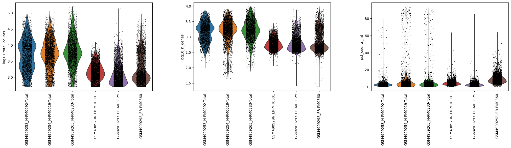
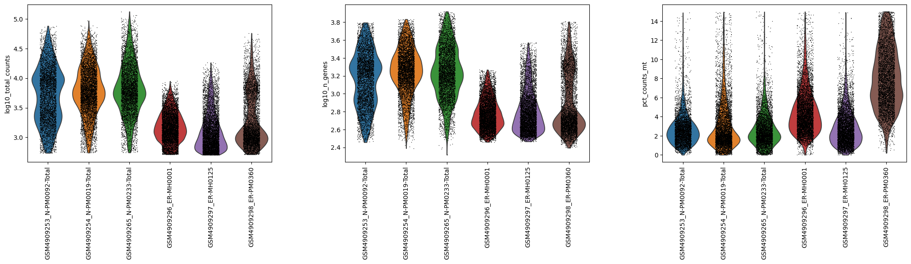
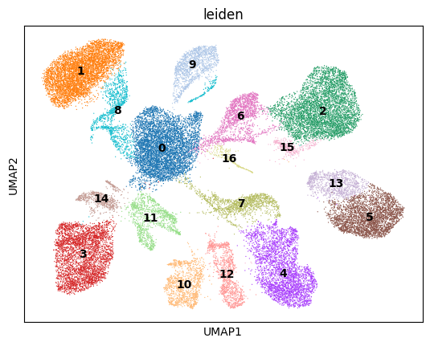
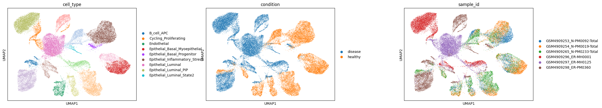
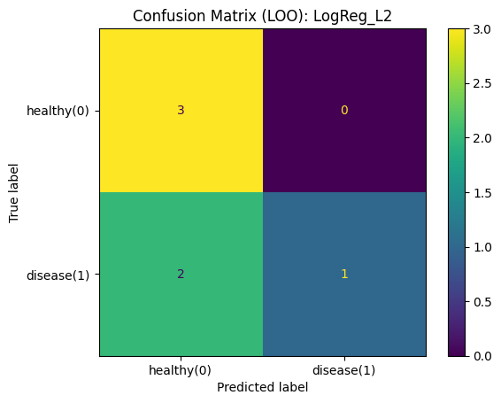
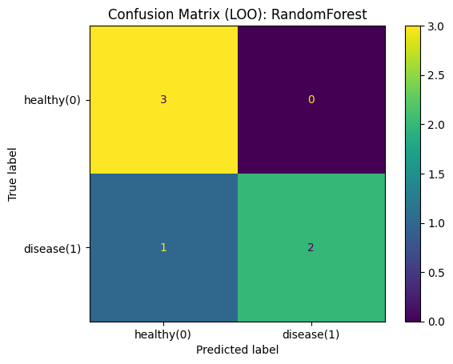

# Single-Cell RNA-seq Analysis of Breast Cancer

## Overview

This project analyzes single-cell RNA-seq data from six biological samples—three healthy mammary tissue samples and three estrogen receptor-positive (ER+) breast tumors—to characterize cellular heterogeneity and explore sample-level disease classification.

The workflow integrates quality control, normalization, dimensionality reduction, BBKNN-based batch-aware clustering, marker-based cell-type annotation, differential expression, and exploratory machine-learning evaluation. The project connects cellular characterization with interpretable gene-expression features in a clinically oriented research context.

## Research Objectives

- Characterize cellular heterogeneity in healthy mammary tissue and ER+ breast tumors.
- Identify transcriptional clusters and assign cell-type labels using marker-gene expression.
- Examine condition-associated expression differences within eligible cell types.
- Explore whether cell-type-specific gene-expression signatures distinguish healthy tissue from ER+ tumors.
- Compare supervised classifiers and examine their predictive features.

## Analytical Workflow

1. **Dataset loading:** Integrate six biological samples while retaining sample and condition metadata.
2. **Quality control:** Assess library size, detected genes, and mitochondrial-read percentage; apply sample-aware filtering.
3. **Normalization and feature selection:** Normalize and log-transform expression, then identify 2,000 highly variable genes.
4. **Dimensionality reduction:** Apply PCA, UMAP, neighborhood graph construction, and preliminary Leiden clustering.
5. **Batch-aware clustering:** Use BBKNN to construct a batch-balanced neighborhood graph and identify 17 final transcriptional clusters.
6. **Cell-type annotation and differential expression:** Annotate the clusters and compare healthy and tumor cells within eligible populations.
7. **Feature engineering:** Select a 244-gene signature across eight cell types and construct 1,952 cell-type-specific expression features per sample.
8. **Model evaluation:** Compare L2-regularized logistic regression and Random Forest using leave-one-sample-out cross-validation.
9. **Interpretation:** Examine per-sample predictions and link logistic regression coefficients to cell-type-specific differential-expression results.
10. **Synthesis:** Consolidate model metrics, prediction outcomes, and candidate expression features.

## Selected Results

- **36,490 cells** retained after quality control.
- **2,000 highly variable genes** selected for downstream analysis.
- **17 transcriptional clusters** identified after BBKNN-based clustering.
- **244 selected genes** represented across eight cell types.
- **1,952 cell-type-specific expression features** constructed across six biological samples.

The saved notebook outputs report the following exploratory classification results:

| Metric | Logistic Regression | Random Forest |
|---|---:|---:|
| Accuracy | 0.667 | 0.833 |
| Precision | 1.000 | 1.000 |
| Recall | 0.333 | 0.667 |
| F1 score | 0.500 | 0.800 |
| ROC-AUC | 1.000 | 1.000 |

The dataset contains only six biological samples, and DEG-based feature selection occurs before cross-validation in the current workflow; therefore, these results should be interpreted as exploratory rather than as an independent estimate of clinical diagnostic performance.

## Selected Figures
### Quality control

QC distributions were examined across samples before and after filtering to assess library size, detected genes, and mitochondrial-read percentage.

### Clustering and cell-type annotation

The BBKNN neighborhood graph was used for final Leiden clustering. Cluster annotations were then visualized alongside sample identity and condition to support interpretation of the cellular composition.

  

  

### Exploratory classifier evaluation

The sample-level expression matrix was evaluated using leave-one-sample-out cross-validation. The confusion matrices below summarize held-out predictions for each classifier.

  
  

## Methods and Tools

- **Single-cell analysis:** Scanpy, AnnData
- **Dimensionality reduction and visualization:** PCA, UMAP
- **Clustering and batch integration:** Leiden, BBKNN
- **Differential expression:** Wilcoxon rank-sum testing with multiple-testing correction
- **Machine learning:** scikit-learn, logistic regression, Random Forest
- **Evaluation:** Leave-one-sample-out cross-validation, confusion matrices, ROC curves, and coefficient-based feature interpretation
- **Environment:** Python and Google Colab

## Dataset

The analysis uses data associated with [GEO accession GSE161529](https://www.ncbi.nlm.nih.gov/geo/query/acc.cgi?acc=GSE161529), comprising three healthy mammary tissue samples and three ER+ breast tumor samples.

Raw count matrices, barcode files, and the shared feature annotation are not included in this repository. Obtain the required files from GEO and place them in the `data/` directory using the filenames expected by the notebook.

## Repository Contents

- `single_cell_rnaseq_breast_cancer.ipynb` — end-to-end analysis notebook.
- `figures/` — selected figures exported from the notebook's saved outputs.
- `.gitignore` — excludes raw data, large intermediate AnnData objects, and temporary notebook files.

## Reproducibility

The notebook is configured for Google Colab and Google Drive. Exploring the existing notebook outputs does not require the original data files, but reproducing the full pipeline requires obtaining the source data, installing the required dependencies, and regenerating the intermediate files.
